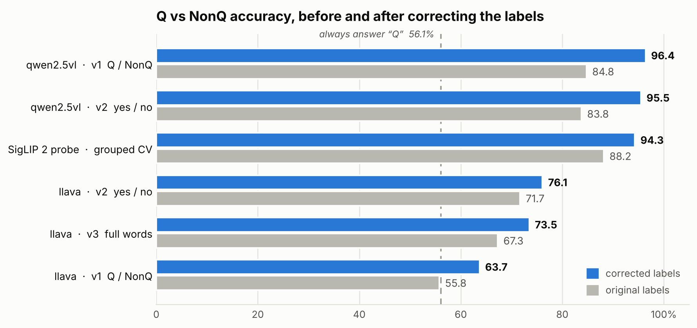

# Phase 1 — Q vs NonQ classification

**Question:** can a figure extracted from a paper be classified automatically
as quantitative (Q — a chart or plot that encodes data values) or
non-quantitative (NonQ — code listing, schema/UML, screenshot, table as an
image, photograph)?

> **Summary.** Two approaches were tried: zero-shot vision-language models, and
> a frozen image encoder with a small trained classifier. Measured against the
> ground truth as originally derived, the trained classifier looked better
> (88.2% vs 84.8%). Re-checking every label by hand against its image showed
> that 13 of 123 labels were wrong — and that the vision-language model had
> been right on all 13. On the corrected ground truth the ranking reverses:
> **qwen2.5vl reaches 96.4% with perfect recall on quantitative figures**,
> against 94.3% for the trained classifier.
>
> The largest single improvement in this phase came from fixing the data, not
> from changing the method.

## Setup

- **Corpus:** 24 ESEM 2022 papers.
- **Ground truth:** figure types hand-labelled by the authors of the Torchiano
  & Laudadio study (`ESEM2022.csv`), mapped to Q / NonQ using the taxonomy in
  `GraphTypes.csv`, then matched to the images extracted by `find_images.py`.
- **Evaluation set (as originally derived): 112 figures from 23 papers.**
  Majority-class baseline (always answer Q): **60.7%**.

Sections 1–3 use this original ground truth. Section 4 describes how it was
corrected and what changed.

---

# 1. First approach — zero-shot vision-language models

## Method

Each figure is sent to a vision-language model running locally through Ollama,
one image at a time, with a single instruction. The model's answer is saved per
figure to its own CSV, and that CSV is then scored against the ground truth.

The models are used **zero-shot**: no fine-tuning, no training data, no
examples in the prompt. Only the model and the wording of the question change
between runs.

**Models.** `llava` (7B) and `qwen2.5vl:7b` (7B) — same parameter count, so the
comparison between them is like-for-like.

**Prompts.**

- **v1 — abbreviated labels:**
  *"Does this figure show quantitative data (a chart or plot with numbers,
  axes, bars, lines, points)? Answer with one word only: Q or NonQ."*
- **v2 — yes / no:**
  *"Does this image show a chart, plot or graph that displays data values?
  Answer only yes or no."*
- **v3 — full words:**
  *"Is this figure quantitative (a chart or plot showing data values) or
  non-quantitative? Answer with one word: quantitative or non-quantitative."*

## Results (original labels)

| # | Model | Prompt | Accuracy |
|---|---|---|---|
| — | majority class | always answer "Q" | 60.7% |
| 1 | llava 7B | v1 — Q / NonQ | 55.8% |
| 2 | llava 7B | v2 — yes / no | 71.7% |
| 3 | llava 7B | v3 — quantitative / non-quantitative | 67.3% |
| 4 | qwen2.5vl 7B | v1 — Q / NonQ | **84.8%** |
| 5 | qwen2.5vl 7B | v2 — yes / no | 83.8% |

### Per-class recall

| # | Model + prompt | n | Q recall | NonQ recall |
|---|---|---|---|---|
| 1 | llava v1 | 113 | 0.35 (24/69) | 0.89 (39/44) |
| 2 | llava v2 | 113 | 0.65 (45/69) | 0.82 (36/44) |
| 3 | llava v3 | 113 | 0.65 (45/69) | 0.70 (31/44) |
| 4 | qwen v1 | 112 | 0.86 (59/69) | 0.84 (36/43) |
| 5 | qwen v2 | 111 | 0.85 (57/67) | 0.82 (36/44) |

n varies slightly: one oversized figure exceeds qwen's context window and
returns an error.

### Confusion matrices

**llava v1 — 55.8%**

|            | said NonQ | said Q |
|------------|-----------|--------|
| truly NonQ | 39        | 5      |
| truly Q    | 45        | 24     |

**llava v2 — 71.7%**

|            | said NonQ | said Q |
|------------|-----------|--------|
| truly NonQ | 36        | 8      |
| truly Q    | 24        | 45     |

**llava v3 — 67.3%**

|            | said NonQ | said Q |
|------------|-----------|--------|
| truly NonQ | 31        | 13     |
| truly Q    | 24        | 45     |

**qwen2.5vl v1 — 84.8%**

|            | said NonQ | said Q |
|------------|-----------|--------|
| truly NonQ | 36        | 7      |
| truly Q    | 10        | 59     |

**qwen2.5vl v2 — 83.8%**

|            | said NonQ | said Q |
|------------|-----------|--------|
| truly NonQ | 36        | 8      |
| truly Q    | 10        | 57     |

## Findings

### 1.1 Model choice dominates prompt wording

With the **identical** prompt (v1):

```
llava 7B        55.8%     Q recall 0.35
qwen2.5vl 7B    84.8%     Q recall 0.86
```

Both models are 7B parameters. llava sits *below* the 60.7% majority baseline:
it answers NonQ for 84 of 113 images when only 44 are NonQ, so it is
effectively guessing on quantitative figures.

### 1.2 Prompt wording rescues a weak model, but does nothing for a strong one

```
llava:   v1 55.8%  →  v2 71.7%     (+15.9 points)
qwen:    v1 84.8%  →  v2 83.8%     (−1.0 point)
```

The gain from rewording the prompt appears only on llava. Once the model is
capable enough, the same rewording makes no difference; the 1-point drop is
well inside noise at n ≈ 112.

Interpretation: "Q" and "NonQ" are labels invented by this study, with no
grounding in the models' training data. A weaker model cannot map them onto the
underlying concept and falls back on guessing, while a stronger one infers the
intent from the definition given in the prompt.

**Practical implication:** prompt engineering acts as a remedy for model
weakness rather than as an independent lever. Effort is better spent on model
choice.

## Run time

Measured on 10 figures per model, on the same machine (Apple Silicon laptop,
models served by Ollama), after one warm-up call so that model loading is not
counted.

| Model | Ollama tag | Seconds per figure | 112 figures | 6342 figures |
|---|---|---|---|---|
| llava 7B | `llava:latest` | ~8 s | 15 min | **14 hours** |
| qwen2.5vl 7B | `qwen2.5vl:7b` | ~63 s | 118 min | **4.6 days** |

**qwen is roughly 8× slower than llava**, despite both being 7B models. The
cause is the same one that forces a larger context window: qwen encodes an
image into far more tokens than llava, so there is more to process per figure.
The accuracy is paid for in time.

The 6342-figure column is a projection to the size of the full Torchiano &
Laudadio corpus (865 papers across ESEM, ICSE, TSE and EMSE), not a measured
run — only the ESEM 2022 slice is available here.

These timings are approximate: with a sample of 10 figures and considerable
variation in figure size, they are reliable to roughly ±20%. The 8× ratio is
far larger than that margin; the individual second-counts should not be quoted
precisely.

## Practical notes

- **Context window.** qwen2.5vl encodes images into far more tokens than llava.
  The default 4096-token context overflows on larger figures; `num_ctx` must be
  raised to 16384. One figure still exceeds that and errors out.
- **Robustness.** The classification loop writes its CSV after every figure and
  catches per-image exceptions, so a failure partway through does not lose the
  earlier answers.
- **Saving per-run answers pays off.** Because every run's per-figure answers
  are on disk, re-scoring against a different ground truth costs nothing — no
  model re-runs are needed. This mattered in section 4.
- **Answer format.** Both models follow a one-word instruction reliably, but
  qwen appends a full stop ("Yes."), so answers are normalised before
  comparison. A vague prompt ("what type of figure is this?") instead returns a
  paragraph of prose, and in the one case tested named the wrong chart type.

---

# 2. Second approach — frozen encoder + linear probe

## Why a second approach

The vision-language results appeared to plateau around 85%, and further prompt
changes gave no gain on the stronger model (84.8% → 83.8%). The remaining
levers on a zero-shot VLM are a bigger model or more elaborate prompting, both
of which cost compute and neither of which uses the labelled data that already
exists.

Three reasons made a trained classifier worth trying:

1. **Cost.** A vision-language model does two things: it *looks* at the image,
   then it *writes* an answer in words. Only the first is needed here. Keeping
   the visual part and dropping the language part is two to three orders of
   magnitude cheaper per figure — which matters for a corpus of 6342 figures,
   even if it does not for 112.
2. **It can learn from the labels.** A zero-shot VLM is fixed: it cannot get
   better as more figures are labelled. A trained classifier can.
3. **It is unmeasured.** No published results exist for linear probes on frozen
   encoders for scientific-figure classification, so the measurement is a
   contribution in itself, whichever way it comes out.

Fine-tuning was ruled out: with ~110 labelled figures there is far too little
data, and published 2026 results report that LoRA fine-tuning on only dozens of
examples per class degrades performance rather than improving it. A linear probe
on frozen features is the standard low-data alternative.

## Method

1. A frozen SigLIP 2 image encoder (`google/siglip2-base-patch16-224`, ~90M
   parameters) turns each figure into a 768-dimensional embedding. The encoder
   is never trained or modified.
2. A logistic regression (`StandardScaler` → `LogisticRegression(C=1.0)`) is
   trained on those embeddings to output Q or NonQ. Only a few hundred
   parameters are learned, against ~7 billion in the VLMs.
3. `C = 1.0` was fixed in advance, not tuned on the evaluation data.
4. Validation: `StratifiedGroupKFold(5)`, **grouped by paper**, so figures from
   the same paper never appear in both a training and a test fold. Without
   grouping, the classifier can learn a paper's plotting style instead of the
   Q / NonQ distinction.

Run in Google Colab on a free T4 GPU. Embeddings are computed once and cached,
so later experiments take seconds.

### About the encoder

`google/siglip2-base-patch16-224` is a specific pretrained model, downloaded
and used as-is. It is not a vision-language model and cannot answer questions:
it takes an image and returns 768 numbers, nothing else.

| | qwen2.5vl (approach 1) | SigLIP 2 (approach 2) |
|---|---|---|
| Input | image + question | image only |
| Output | text | 768-dimensional vector |
| Can follow an instruction | yes | no |
| Parameters | ~7B | ~90M |

SigLIP 2 was trained by Google on a very large set of image–caption pairs, with
the objective that an image's representation lands close to its caption's. The
resulting embedding space is therefore semantic rather than arbitrary: images of
charts fall in one region, images of code in another. This is what the PCA /
t-SNE view shows, and it is why a classifier with only a few hundred parameters
is sufficient.

Reading the name: `base` is the size (`large` and `so400m` variants also exist),
`patch16` means the image is divided into 16×16-pixel tiles, and `224` means
every image is resized to 224×224 pixels before the model sees it.

**That resizing is a limitation worth noting.** Fine detail — small axis labels,
thin gridlines, tick marks — is lost at 224 pixels. It is unlikely to matter for
the coarse Q / NonQ decision, but it is likely to matter at stage 4, where
defects such as rotated axis labels or heavy gridlines depend precisely on that
detail. The larger `siglip2-so400m-patch14-384` variant sees images at 384
pixels and is the first alternative to test.

**"Frozen"** means the encoder's weights are never updated. It is used like a
library function: image in, vector out. Only the logistic regression on top is
trained.

## Run time

Measured on 122 figures on a Colab T4 GPU, with
`google/siglip2-base-patch16-224` as the encoder.

| Step | Time |
|---|---|
| Encoding (`google/siglip2-base-patch16-224`, frozen) | 5.34 s total — **43.8 ms per figure** |
| Training the classifier | 70 ms, once, for the whole dataset |
| Predicting | 0.043 ms per figure |
| **Projected for 6342 figures** | **4.6 minutes** |

Almost all the cost is the encoder. Training the logistic regression is a
one-off 70 ms for the entire dataset, and predicting is 0.043 ms per figure —
about a thousand times cheaper than encoding, and effectively free.

Note that training time does not recur: once fitted, the classifier is reused.
Only the encoding happens per figure.

## Results (original labels)

Evaluated on 110 figures from 23 papers.

| Method | Accuracy |
|---|---|
| always answer "Q" | 60.9% |
| **SigLIP 2 + logistic probe, grouped CV** | **88.2%** (97/110) |
| same probe, ungrouped CV | 90.0% (99/110) |

**The grouped figure is the one to report.** The ungrouped figure is inflated:
it lets the classifier see figures from the same paper in both training and
testing, so it can recognise an author's plotting style rather than the
distinction being measured. The gap between the two is a direct measure of how
much that leakage is worth.

A PCA / t-SNE view of the embeddings shows the two classes already separating
before any training, which is why so small a classifier suffices. Those plots
are illustration, not evidence.

---

# 3. Comparing the two approaches (original labels)

| Approach | Accuracy | Trained? | Parameters | Time per figure |
|---|---|---|---|---|
| llava 7B, zero-shot | 71.7% | no | ~7B | ~8 s |
| qwen2.5vl 7B, zero-shot | 84.8% | no | ~7B | ~63 s |
| SigLIP 2 + linear probe | **88.2%** | yes (a few hundred parameters) | ~90M | ~44 ms |

On this ground truth the trained classifier leads by 3.4 points while using
roughly 100–300× less compute. That was the state of the work before the labels
were examined.

### Cost at scale

| Approach | Model | Parameters | Hardware | Per figure | 112 figures | 6342 figures |
|---|---|---|---|---|---|---|
| 1 | `llava:latest` | ~7B | laptop (Ollama) | ~8 s | 15 min | 14 hours |
| 1 | `qwen2.5vl:7b` | ~7B | laptop (Ollama) | ~63 s | 118 min | **4.6 days** |
| 2 | `google/siglip2-base-patch16-224` + logistic regression | ~90M | Colab T4 GPU | ~44 ms | 5 s | **4.6 minutes** |

The probe is roughly **1400× faster per figure** than qwen. For the full
Torchiano corpus that is the difference between 4.6 days and 4.6 minutes.

This gap is the probe's main argument, and it survives the label correction that
removed its accuracy advantage. It does not matter for the end-use case — an
author checking a seven-figure paper waits about seven minutes with qwen, which
is tolerable — but it matters for building and validating the tool over
thousands of figures, and it will matter at stage 4, where roughly 28 questions
per figure multiply the VLM's cost while leaving the probe's encoding cost
unchanged.

**Caveats, already true at this point:**

- The gap is **not statistically significant.** At n ≈ 110 the confidence
  intervals overlap (the 95% CI for 88.2% is roughly 81–93%). McNemar's test on
  the paired predictions is still to be run.
- The two are not measured on an identical row set (110 vs 112), which must be
  fixed before any paired test.
- The protocols differ: the VLM is evaluated zero-shot on every figure, the
  probe through cross-validation.
- The timings are not a like-for-like comparison: the VLMs are timed on an
  Apple Silicon laptop through Ollama, the probe on a Colab T4 GPU. Parameter
  count (~7B vs ~90M) is the hardware-independent comparison, and a same-machine
  benchmark would be needed for an exact wall-clock figure. The measured ratio
  (~1400×) is far larger than any plausible hardware effect, so the conclusion
  holds, but the precise multiplier should not be quoted as if both ran on
  identical hardware.

---

# 4. Correcting the ground truth

## Why it was necessary

Inspecting individual errors showed cases where the model's answer looked
correct and the label did not. That prompted a full manual re-check: **every
figure was opened and compared against its own label.**

Two classes of problem were found:

- **Bad crops** — images where the extractor had cut out the wrong region of
  the page, so the file did not show the figure it claimed to.
- **Wrong labels** — figures whose Q / NonQ label did not match the image.

The corrected file is `labels_cleaned.csv`.

## What was wrong

**13 of 123 labels (11%).** Ten share one cause: the original annotation used
the type name `Dendogram` loosely, for any tree-shaped diagram. A dendrogram
proper is a quantitative clustering plot, so the mapping rule placed all of them
in Q — but on inspection these figures are flowcharts, block diagrams,
dependency graphs and plain tree diagrams, all NonQ schemas. The other three
were labelled `Schema` but are in fact a funnel chart and two network graphs
that encode quantities.

| Correction | Count | Original type → actual content |
|---|---|---|
| Q → NonQ | 10 | `Dendogram` → tree diagram, flowchart, block diagram, dependency graph |
| NonQ → Q | 3 | `Schema` → funnel chart, network graph ×2 |

The re-check also recovered 11 figures previously excluded because no matching
image was found. The corrected set is **123 figures from 23 papers — 69 Q,
54 NonQ**, with a majority-class baseline of **56.1%**.

## The outcome for each approach

Each run was re-scored against the corrected key. **The model answers are
unchanged** — only the answer key differs, so no model was re-run.

| Approach | Original labels | Corrected labels | Δ |
|---|---|---|---|
| majority class | 60.7% | 56.1% | — |
| llava v1 — Q / NonQ | 55.8% | 63.7% | +7.9 |
| llava v2 — yes / no | 71.7% | 76.1% | +4.4 |
| llava v3 — full words | 67.3% | 73.5% | +6.2 |
| **qwen2.5vl v1 — Q / NonQ** | 84.8% | **96.4%** | **+11.6** |
| qwen2.5vl v2 — yes / no | 83.8% | 95.5% | +11.7 |
| **SigLIP 2 probe, grouped CV** | 88.2% | **94.3%** | +6.1 |
| SigLIP 2 probe, ungrouped CV | 90.0% | 97.5% | +7.5 |



### qwen after correction

| # | Model + prompt | n | Q recall | NonQ recall |
|---|---|---|---|---|
| 4 | qwen v1 | 112 | **1.00 (62/62)** | 0.92 (46/50) |
| 5 | qwen v2 | 111 | **1.00 (60/60)** | 0.90 (46/51) |

**qwen2.5vl v1 — 96.4%**

|            | said NonQ | said Q |
|------------|-----------|--------|
| truly NonQ | 46        | 4      |
| truly Q    | **0**     | 62     |

## What this means

**On all 13 corrected figures, qwen had given the corrected answer — 13 out of
13.** Every one was counted as a model error under the original labels. The
model was right; the ground truth was wrong.

Three consequences:

1. **What looked like an 11-point model deficiency was annotation error.**
   Measured model quality is bounded above by label quality, and an accuracy
   figure reported against unverified labels understates a model that is already
   close to the ceiling.

2. **The ranking reverses.** The probe led before (88.2% vs 84.8%) and trails
   after (94.3% vs 96.4%). Its apparent advantage was an artefact: the
   mislabelled figures were ones qwen classified correctly and llava largely did
   not, so correcting them helped qwen roughly twice as much as llava. The
   correction did not simply shift every score upward — it changed which method
   looks best.

3. **The remaining errors are all in one direction.** qwen now has Q recall 1.00
   and NonQ recall 0.92: every remaining error is a non-quantitative figure
   called quantitative, never the reverse. For the pipeline this is the
   preferable failure mode — no quantitative figure is lost before the later
   stages, and the four false positives should be caught at stage 3, when no
   chart type fits.

## Where that leaves the two approaches

**The headline method for stage 1 is the vision-language model**, at 96.4% with
perfect recall on quantitative figures.

The probe remains worth carrying forward, for the reasons it was built: it is
100–300× cheaper per figure, which matters at the scale of the full 6342-figure
corpus; it improves as more labels are added, whereas the zero-shot VLM is
fixed; and the measurement itself is unpublished.

**Outstanding before this comparison is final:**

- McNemar's test on an identical row set — the probe is scored on 122 figures
  and qwen on 112, and the remaining 2-point gap may not survive at n ≈ 120.
- Fold composition under grouping by paper is uneven: the Q share per fold
  ranges from 0.20 to 0.83, because an ESEM paper tends to contain either mostly
  charts or mostly diagrams. Repeating over several random splits would give a
  more stable estimate.

---

# 5. Next steps

1. McNemar's test: probe vs qwen on an identical row set.
2. Inspect qwen's 4 remaining errors (all NonQ called Q) and the probe's 7.
3. A development / test split before any further prompt tuning.
4. A newer model generation (`qwen3-vl:8b`) for comparison.
5. Structured output (Ollama's `format` with a JSON enum) and temperature 0, so
   answers cannot be invalid and runs are reproducible.
6. Zero-shot SigLIP (text prompts, no training) as a third baseline.
7. Other encoders, as a controlled experiment — same data, same classifier,
   same validation, only the encoder changes:
   `siglip2-so400m-patch14-384` (same family, larger, 384px input),
   `facebook/dinov3-base` (self-supervised, no text alignment) and
   `openai/clip-vit-base-patch32` (the older standard, as a reference point).
   With n ≈ 122 a difference of 1–2 points is not meaningful; only a large gap,
   or one confirmed over several random splits, should be reported as a result.
8. ~~Measure the probe's own run time per figure~~ — done (43.8 ms encoding,
   0.043 ms prediction). Still worth repeating on the same machine as the VLMs
   for an exact like-for-like figure.

# 6. Then: stages 2–4

- **Stage 2** — NonQ subtype (Code, Graph, Picture, Schema, Screenshot, Table,
  Wordcloud). The label corrections in section 4 suggest the original taxonomy
  was applied loosely in practice, which will matter more here than at stage 1.
- **Stage 3** — chart type (~25 classes). The distribution is long-tailed: Bar
  36.8%, Boxplot 19.6% and Line 18.7% of quantitative figures, every other type
  under 3%. Most types have 0–2 examples in this corpus, so external labelled
  data will be needed — Torchiano's full `SEVizData.csv` covers 6342 figures.
- **Stage 4** — the 28 defects. Published results suggest this is much harder:
  on the Misviz benchmark a 7B model identified the exact set of chart defects
  only 5.2% of the time. Likely approach: one binary question per defect rather
  than "list all defects", plus rule-based detection where possible (Raster =
  check whether the PDF object is a bitmap; RotatedXLabels = OCR text-box
  angle; axis defects = tick extraction).

# Appendix — file formats

`labels_cleaned.csv` is semicolon-separated with a title line, so it must be
read as `sep=";", skiprows=1`. It should not be opened and saved in Excel or
Numbers, which corrupts the format.
